# ЛР4 — Файлы: TXT/CSV и отчёты по текстовой статистике

## Задание A — модуль `src/lab04/io_txt_csv.py`

Реализованы функции:

### 1. `read_text(path: str | Path, encoding: str = "utf-8") -> str`

Возвращает строку - все символы из файла.

Функция читает весь файл целиком. В задачах с большими объёмами стоит читать прострочно!

Если файла не существует возникает исключение FileNotFoundError

Взаимодействие с файлами производится в соответствии с RAII (Resource Acquizition Is Initialization). Метод `read_text` освобождает ресурсы после использования.

Path class из pathlib кросс-платформенно оперирует путям. (Python 3.5+):
``` python
    p = Path(path)
    result_str = p.read_text(encoding=encoding)
```

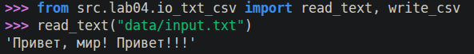

### 2. `write_csv(rows: list[tuple | list], path: str | Path, header: tuple[str, ...] | None = None) -> None`  

Создаёт или перезаписывает файл по данному пути.

Проверяет, что строки одинаковой длины
``` python
    if len(rows) > 0 and not all(len(row) == len(rows[0]) for row in rows):
            raise ValueError("rows must be same length")

```
Использует pathlib.
``` python
    p = Path(path)

    # Ensure parent dirs exist
    p.parent.mkdir(parents=True, exist_ok=True)

    with p.open("w", newline="", encoding=ENCODING) as file:
        w = csv.writer(file)
        if header is not None:
            w.writerow(header)
        for row in rows:
            w.writerow(row)
```

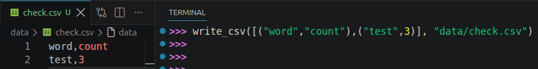

## Задание B — скрипт `src/lab04/text_report.py`

Считает токены в файлах, сохраняет отчет в csv.

Используются операции с текстом `normalize, tokenize, count_freq, top_n` и функцию консольного вывода `print_summary` из лабораторной работы 3.

Если файла не существует возникает исключение FileNotFoundError в read_text.

``` python
    for cur_in_path in in_path_list:
        cur_str = read_text(cur_in_path, args.encoding)
        cur_str = normalize(cur_str)

        cur_tokens = tokenize(cur_str)
        cur_freqs = count_freq(cur_tokens)

        per_file_freqs.extend([(cur_in_path.name, word, count) for word, count in cur_freqs.items()])

        for word, count in cur_freqs.items():
            sum_freqs[word] = sum_freqs.get(word, 0) + count


    if multiple_files:
        per_file_freqs = merge_sorted(per_file_freqs, key= lambda x: (x[0], -x[2], x[1]))

        per_file_path = Path(args.per_file_path)
        write_csv(rows=per_file_freqs, path=per_file_path, header=HEADER_PER_FILE)


    sum_top = top_n(sum_freqs, len(sum_freqs))

    total_path = Path(args.total_path)
    write_csv(rows=sum_top, path=total_path, header=HEADER_TOTAL)

    print(total_path.name)
    print_summary(total_tokens=sum(sum_freqs.values()),
                  unique_tokens=len(sum_freqs),
                  table=sum_top[:TOP_QUANTITY])

```
### Тест A. Один файл (база)

Содержание input.txt

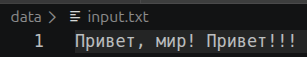

Запуск в консоли

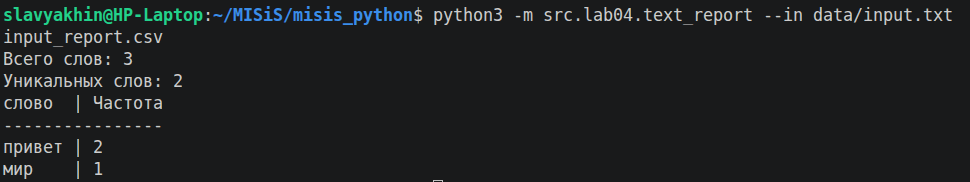

Итоговый csv

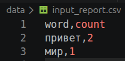

### Тест B. Пустой файл

Если файл пустой, отчет будет содержать только заголовок.

Содержание empty.txt

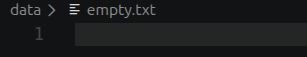

Запуск в консоли

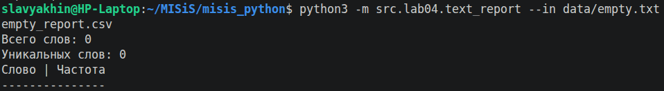

Итоговый csv

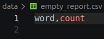

### Тест C. Кодировка cp1251

Скрипт принимает в аргумент `--encoding` кодировку.

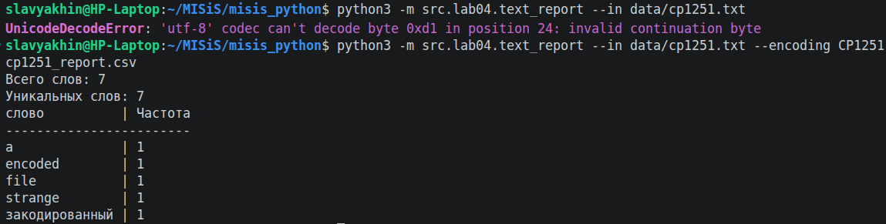

Для конвертации файла в другую кодировку можно использовать утилиту `iconv` (GNU). Например:
`iconv -f UTF-8 -t CP1251 data/utf-8.txt -o data/cp1251.txt`

### Тест D. Несколько файлов (пер-файл и сводный)

Есть возможность передавать несколько файлов на вход:

#### Вариант по отчету на каждый файл

Код первого варианта сохранен в истории коммитов.

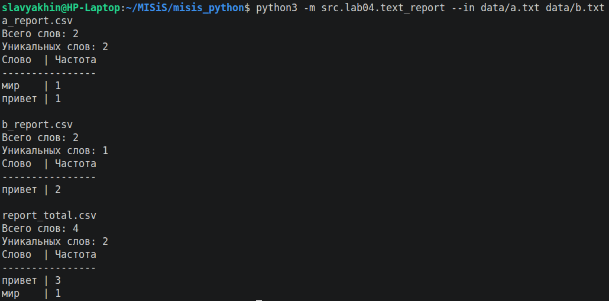

#### Вариант как в ТЗ

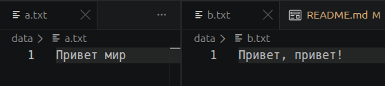

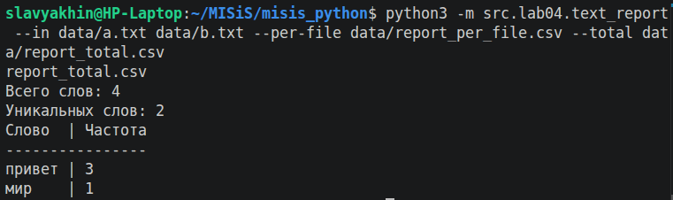

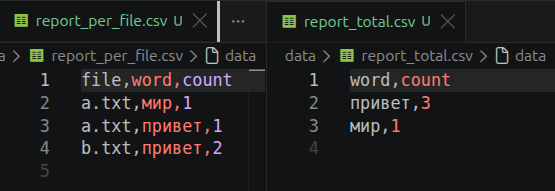
