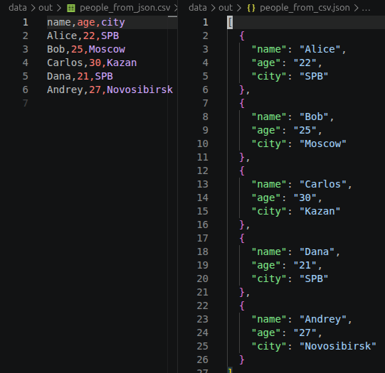
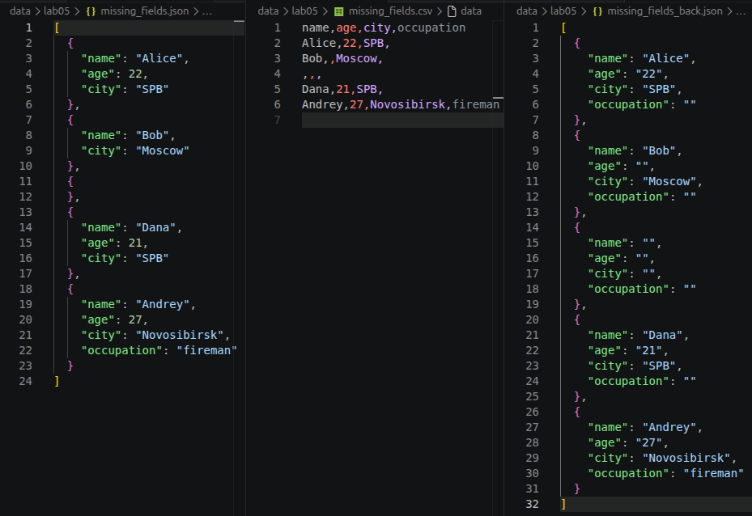
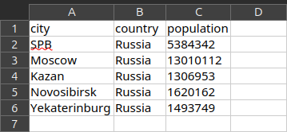

# ЛР5 — JSON и конвертации (JSON↔CSV, CSV→XLSX)

## Задание A — JSON ↔ CSV

Реализован модуль `src/lab05/json_csv.py` с функциями:

### json_to_csv(json_path: str, csv_path: str) -> None

Преобразует JSON-файл в CSV.

Поддерживает список словарей [{...}, {...}], заполняет отсутствующие поля пустыми строками.
Кодировка UTF-8. Порядок колонок — как впервые встречаются в объектах.

**in-memory**

Загружает весть список словарей в динамическую память. Для больших таблиц возможно стоит использовать более сложные парсеры (например, ijson), чтобы читать и обрабатывать по-элементно.

Чтение всего списка целиком. В результате data должен быть `list[dict]`
``` python
    json_path_path = Path(json_path)
    with json_path_path.open(encoding=ENCODING) as f:
        data = json.load(f)
```

Колонки берутся как **все возможные ключи**. Используется метод `flatten` из ЛР2.
``` python
    headers = dict.fromkeys(
            flatten(list(
            list(d.keys()) for d in data
            )))
```

Запись csv.
``` python
    csv_path_path = Path(csv_path)
    with csv_path_path.open("w", encoding=ENCODING) as f:
        w = csv.DictWriter(f, headers)
        w.writeheader()
        w.writerows(data)
```

### csv_to_json(csv_path: str, json_path: str) -> None

Преобразует CSV в JSON (список словарей).
Заголовок обязателен, значения сохраняются как строки.
json.dump(..., ensure_ascii=False, indent=2)

Аналогично **in-memory**

Без аргумента `fieldnames` значения в первой строке csv файла принимаются за названия колонок - ключи. В случае, если файл пустой или состоит из одной строки поднимется `ValueError`
``` python
    csv_path_path = Path(csv_path)
    with csv_path_path.open(encoding=ENCODING) as f:
        r = csv.DictReader(f) # fieldnames omitted
        data = list(r) # list of dicts

    if not data:
        raise ValueError("Empty csv or missing column names")

    json_path_path = Path(json_path)
    with json_path_path.open("w", encoding=ENCODING) as f:
        json.dump(data, f, ensure_ascii=False, indent=2)
```

#### Примеры

Подготовленный набор



Набор с пустыми полями. Недостающие поля заполняются пустыми строками.



## Задание B — CSV → XLSX

Реализован модуль `src/lab05/csv_xlsx.py` c функциями:

### csv_to_xlsx(csv_path: str, xlsx_path: str) -> None

Конвертирует CSV в XLSX.

Использовать openpyxl ИЛИ xlsxwriter.
Первая строка CSV — заголовок.
Лист называется "Sheet1".
Колонки — автоширина по длине текста (не менее 8 символов).

Создание "книги". Автоматически создаётся один лист.
``` python
    wb = Workbook()
    ws = wb.active

    if ws is None:
        raise RuntimeError("Workbook has no active worksheet")

    ws.title = TITLE
```

Поиск самых длинных значений в каждом столбце. В дальнейшем установим по ним ширины.
``` python

    column_widths = dict()

    csv_path_path = Path(csv_path)
    with csv_path_path.open(encoding=ENCODING) as f:
        for row in csv.reader(f):
            ws.append(row)

            # Find width for each column
            for i, s in enumerate(row):
                column_widths[i+1] = max( # column indexes start with 1
                    column_widths.get(i+1, MIN_COL_WIDTH),
                    len(s))
```

Установка ширин столбцов и сохранение книги в файл
``` python
    for i in column_widths:
        print(column_widths[i])
        ws.column_dimensions[get_column_letter(i)].width = column_widths[i]

    xlsx_path_path = Path(xlsx_path)
    wb.save(xlsx_path_path)
```

#### Примеры

`>>> csv_to_xlsx("data/samples/cities.csv", "data/out/cities.xlsx")`

