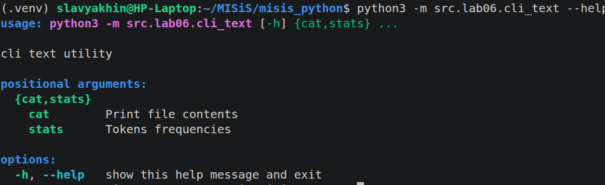
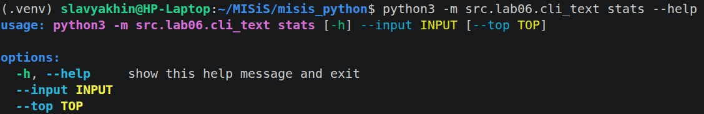
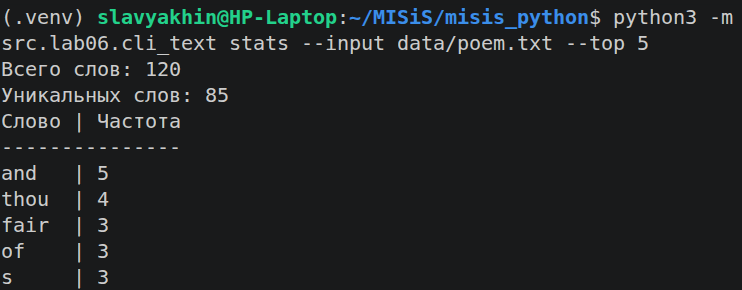
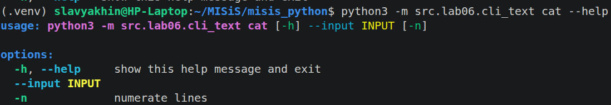
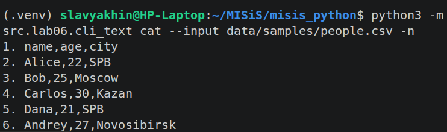
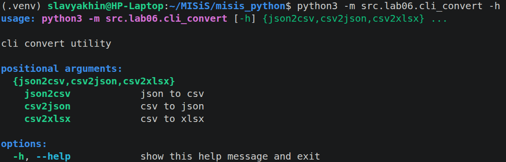
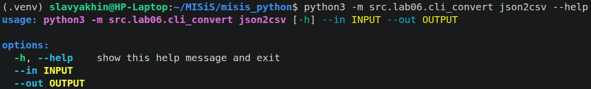
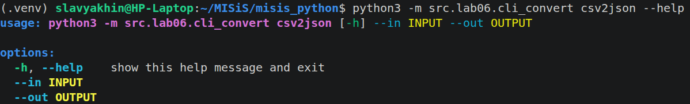
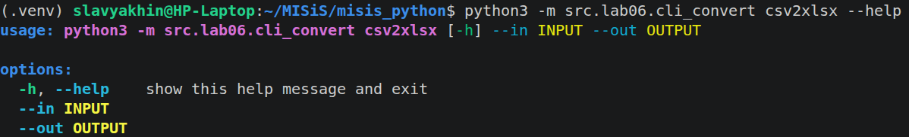

# ЛР6 — CLI‑утилиты с argparse (cat/grep‑lite + конвертеры)

## Задание A — cli_text.py

Модуль `src.lab06.cli_text` с подкомандами:



### `stats --input <txt> [--top 5]`
— анализ частот слов в тексте (использованы функции из `lab03`);


`subparser` для stats. `--top` принимает `int` значение - кол-во строк в топе частых токенов.
```python
    stats_parser = subparsers.add_parser("stats", help="Tokens frequencies")
    stats_parser.add_argument("--input", required=True)
    stats_parser.add_argument("--top", type=int, default=5)
```


Используются функции из `read_text` lab03 и `print_stats` lab04.
```python
            input_path = Path(args.input)
            input_str = read_text(input_path)
            print_stats(input_str, top=args.top)
```


### `cat --input <path> [-n]`
— вывод содержимого файла построчно (с нумерацией при `-n`).

`subparser` для cat. `action="store_true"` сохраняет `true` в переменную `n`, если есть флаг.
``` python
    cat_parser = subparsers.add_parser("cat", help="Print file contents")
    cat_parser.add_argument("--input", required=True)
    cat_parser.add_argument("-n", action="store_true", help="numerate lines")
```


Для нумерации строк необходимо разбить текст по '\n' разделителям. `read_text` функция из lab03
``` python
        case "cat":
            input_path = Path(args.input)
            s = read_text(input_path)
            if args.n:
                for i, s in enumerate(s.split('\n')):
                    print(f'{i+1}. {s}')
            else:
                print(s)
```


## Задание B — cli_convert.py

Модуль `src.lab06.cli_convert` с подкомандами:



### `json2csv --in <path> --out <path>`  
``` python
    json2csv_parser = subparsers.add_parser("json2csv", help="json to csv")
    json2csv_parser.add_argument("--in", dest="input", required=True)
    json2csv_parser.add_argument("--out", dest="output", required=True)
```
``` python
        case "json2csv":
            json_to_csv(args.input, args.output)
```


### `csv2json --in <path> --out <path>`  
``` python
    csv2json_parser = subparsers.add_parser("csv2json", help="csv to json")
    csv2json_parser.add_argument("--in", dest="input", required=True)
    csv2json_parser.add_argument("--out", dest="output", required=True)

```
``` python
        case "csv2json":
            csv_to_json(args.input, args.output)
```


### `csv2xlsx --in <path> --out <path>`  

``` python
    csv2xlsx_parser = subparsers.add_parser("csv2xlsx", help="csv to xlsx")
    csv2xlsx_parser.add_argument("--in", dest="input", required=True)
    csv2xlsx_parser.add_argument("--out", dest="output", required=True)
```
``` python
        case "csv2xlsx":
            csv_to_xlsx(args.input, args.output)
```


