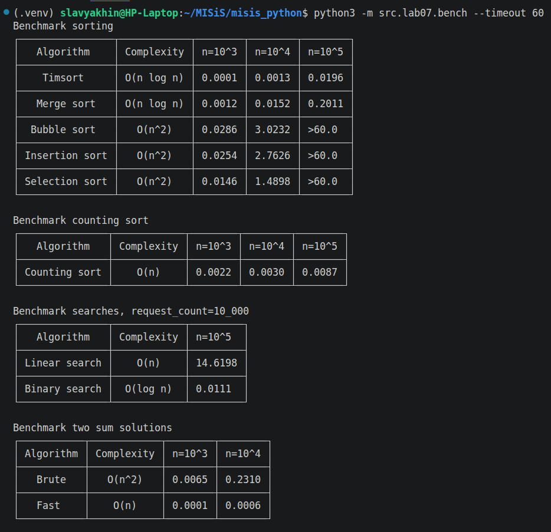

# ЛР7 — Поиск, сортировка и измерение времени


## Задание A. Поиск (`search.py`)

### `linear_search(nums, x) -> int`
— индекс первого вхождения, иначе `-1`

``` python
    for i, num in enumerate(nums):
        if num == x:
            return i

    return -1
```

### `binary_search(sorted_nums, x) -> int`
— индекс любого вхождения, иначе `-1`;

``` python
    if not sorted_nums:
        return -1

    l, r = 0, len(sorted_nums)
    while (r-l > 1):
        m = (l+r) // 2
        if sorted_nums[m] <= x:
            l = m
        else:
            r = m
    if sorted_nums[l] == x:
        return l
    return -1
```
 
### `two_sum_brute(nums, target) -> tuple[int, int] | None`
— пара индексов `(i, j)`, `i < j`, или `None`
Решение за O(n^2)

``` python
    for i in range(len(nums)-1):
        for j in range(i+1, len(nums)):
            if nums[i] + nums[j] == target:
                return (i, j)

    return None
```

### `two_sum_fast(nums, target) tuple[int, int] | None`
— то же через словарь за один проход; при нескольких ответах выбирается с самым маленьким вторым индексом j.

``` python
    for i in range(len(nums)-1):
        for j in range(i+1, len(nums)):
            if nums[i] + nums[j] == target:
                return (i, j)

    return None
```

## Задание B. Сортировки (`sorting.py`)


### `bubble_sorted(nums) -> list`
Сортировка пузырьком имеет квадратичную сложность O(n^2).

Пока список не отсортирован, проходимся по нему, сравнивая пары соседов. Если пара не упорядочена, меняем соседей местами. Таким образом самый крупный неотсортированный элемент "всплывает" на своё место в конце списка. Конец списка отсортирован. Если нечего менять местами, весь список отсортирован.

``` python
    unsorted_count = len(nums_new)
    swapped = True
    while swapped:
        swapped = False
        for i in range(unsorted_count-1):
            if nums_new[i+1] < nums_new[i]:
                nums_new[i], nums_new[i+1] = nums_new[i+1], nums_new[i]
                swapped = True
        unsorted_count -= 1
```

### `insertion_sorted(nums) - > list`
Сортировка вставками имеет квадратичную сложность O(n^2).

Каждую итерацию добавляется элемент в отсортированный префикс списка. Каждый следующий элемент "вставляется" на нужное место - меняется с соседями за O(n).

``` python
    nums_new = nums.copy()

    for i in range(len(nums_new)):
        for j in range(i, 0, -1):
            if nums_new[j] < nums_new[j-1]:
                nums_new[j], nums_new[j-1] = nums_new[j-1], nums_new[j]
```

### `selection_sorted(nums) - > list`
Сортировка выбором имеет квадратичную сложность O(n^2).

Префикс отсортирован. n раз выбирается минимальный элемент за O(n) и меняется местами с элементом сразу после префикса.

``` python
    sorted_count = 0
    while sorted_count < len(nums_new):
        cur_min_ind = sorted_count
        for i in range(sorted_count, len(nums_new)):
            if nums_new[i] < nums_new[cur_min_ind]:
                cur_min_ind = i
        nums_new[sorted_count], nums_new[cur_min_ind] = nums_new[cur_min_ind], nums_new[sorted_count]
        sorted_count += 1
```

### `merge_sorted(nums) -> list` **без рекурсии**
Сортировка слиянием имеет сложность O(nlogn)

Слияние двух отсортированных списков имеет сложность O(n).
Слияние подсписков друг с другом также имеет сложность O(n).

Поделим список сначала на пары элементов - отсортированные списки длины один. Сольём все пары. Получаются отсортированные подсписки длины 2.
Теперь возьмём пары подсписков длины 2 элементов и сольём их. Затем длины 4, 8,... Таких итераций будет logn (логарифм с основанием 2). На последней итерации будем сливать две (возможно неравные) отсортированные половины списка.


``` python
    section_len = 1
    while section_len < len(nums_new):

        for section_a_begin in range(0, len(nums_new), section_len*2):
            section_a_end = min(section_a_begin + section_len, len(nums_new))
            section_b_begin = section_a_end
            section_b_end = min(section_b_begin + section_len, len(nums_new))

            merged_sections = []

            i, j = section_a_begin, section_b_begin
            while i < section_a_end and j < section_b_end:
                if nums_new[i] < nums_new[j]:
                    merged_sections.append(nums_new[i])
                    i += 1
                else:
                    merged_sections.append(nums_new[j])
                    j += 1
            while i < section_a_end:
                merged_sections.append(nums_new[i])
                i += 1
            while j < section_b_end:
                merged_sections.append(nums_new[j])
                j += 1

            for i, value in enumerate(merged_sections):
                nums_new[section_a_begin + i] = value
        
        section_len *= 2
```

### `counting_sorted(nums, lo, hi)` для целых в известном диапазоне
Сортировка подсчётом имеет сложность O(n), однако работает только если входные данные ограничены (варианты с хэш-функциями пока не рассматриваем).

Для каждого значения храним количество его вхождений.

``` python
    counter = [0] * (hi + 1 - lo)
    for value in nums:
        if value < lo or hi < value:
            raise ValueError("nums value not in range [lo, hi]")
        counter[value - lo] += 1

    result = []
    for i, count in enumerate(counter):
        result.extend([i+lo] * count)
```

## Задание C. Проверка против эталона (`check.py`)

В ходе проверки `check` некоторые функции были доработаны. В особенности полезной оказалась сверка своего `binary_search` с `index`. Понадобилось как минимум 3 прогона, чтобы разобраться с upper_bound и lower_bound вариантами бинарного поиска. Результат бинпоиска варьируется в зависимости от строгости условия цикла `while(l < r)` или `while(l <= r)`, от условия в теле цикла и от выбора возвращаемого индекса `l` или `r`.

Таким образом был выбран вариант `lower_bound` - первый в списке или первый больший.

### `check_sorting(fn, trials=100) -> None`

Генерирует случайные списки, выполняет данную сортовку, сравнивает результат с `sorted`
``` python
    for _ in range(trials):
        n = random.randint(0, 50)
        nums = [random.randint(-100, 100) for _ in range(n)]
        original = list(nums)
        result = fn(nums)
        assert result == sorted(nums), f"{fn.__name__} ошиблась на {nums}: {result}"
        assert nums == original, f"{fn.__name__} изменила исходный список"
```

### `check_search() -> None`

Генерирует случайные списки, случайно выбирает цель из списка или выбирает число вообще не из диапазона. В случаее, если числа нет в списке, `index` поднимает ошибку, проверяемые функции возвращают `-1`.

``` python
    for _ in range(trials):
        n = random.randint(0, 50)
        nums = [random.randint(-100, 100) for _ in range(n)]
        nums.sort()

        if not n == 0:
            x = random.choice((nums[random.randint(0, n-1)], 150))
        else:
            x = 150

        result = fn(nums, x)
        try:
            index_result = nums.index(x)
        except ValueError: # not in list
            index_result = -1
        assert result == index_result, f"{fn.__name__} ошиблась на {nums}, {x}: {result}"
```


### `check_two_sum(trials=100) -> None`

Случайно выбирает пару числе из списка и складывает. Решения "two sum" могут быть разные, поэтому сравниваем только факт нахождения и сумму.

``` python
    for _ in range(trials):
        n = random.randint(0, 50)
        nums = [random.randint(-100, 100) for _ in range(n)]
        i, j = random.randint(0, n-1), random.randint(0, n-1)
        su = random.choice((nums[i] + nums[j], 201))

        result_brute = two_sum_brute(nums, su)
        result_fast = two_sum_fast(nums, su)

        assert (result_brute is None and result_fast is None) \
             or (result_brute is not None and result_fast is not None \
                 and nums[result_brute[0]] + nums[result_brute[1]] == nums[result_fast[0]] + nums[result_fast[1]]), f"результаты не совпадают на {nums}: {result_brute} != {result_fast}"
```

## Задание D. Бенчмарк (`bench.py`)

Скрипт, замеряющий время выполнения функций при помощи `timeit`.

Для реализации __timeout__ функции `timeit` выполняются воркером в подпроцессе.
``` python
    times = timeit.repeat(lambda: fn(*args), repeat=repeat, number=number)
    best = min(times) / number
    queue.put(best)
```

В случае исхода данного __timeout__ поднимается исключение:
``` python
    process = mp.Process(target=fn_worker, args=(queue, *fn_args))
    process.start()
    process.join(timeout)

    if process.is_alive():
        process.terminate()
        process.join()
        raise TimeoutError("The execution exceeded the allowed time limit.")

    return queue.get(timeout=1) if not queue.empty() else None
```
queue передаётся для одного процесса, поэтому _состояния гонки_ не возникает.

Данные генерируются дополнительным скриптом `src.lib.gen_numbers`
``` python
    write_csv([(random.randint(min_value, max_value),) for _ in range(n)], out_path , header=HEADER)
```

Табличный вывод в консоль выполняется f-строками `src.lib.fmt_table`
``` python
    print(f"┌─{'─┬─'.join('─' * width for width in widths)}─┐")
    print(f"│ {' │ '.join(f'{value:^{widths[i]}}' for i, value in enumerate(rows[0]))} │")
    for row in rows[1:]:
        print(f"├─{'─┼─'.join('─' * width for width in widths)}─┤")
        print(f"│ {' │ '.join(f'{value:^{widths[i]}}' for i, value in enumerate(row))} │")
    print(f"└─{'─┴─'.join('─' * width for width in widths)}─┘")
```



### __Почему пузырёк при росте `n` в 10 раз замедляется в ~100 раз, а `sorted` — в ~12?__

Согласно асимптотике пузырька, количество операций $n$ на выполнение ограничено $C * n^2, С - конечное\ число$. $(10*n) ^ 2 = 100 * n ^ 2 $.

Тогда как для `Timsort` асимптотика $O(nlong)$: $10n*log(10n) \approx 10n*log10n $ В разных случаях и для разных видов логарифмической сортировки могут быть разные погрешности порядка 10-30 раз.

| Algorithm      | Complexity | n=10^3 | n=10^4 | n=10^5  |
|----------------|------------|--------|--------|---------|
| Timsort        | O(n log n) | 0.0001 | 0.0013 | 0.0196  |
| Merge sort     | O(n log n) | 0.0012 | 0.0152 | 0.2011  |
| Bubble sort    | O(n^2)     | 0.0286 | 3.0232 | >60.0   |
| Insertion sort | O(n^2)     | 0.0254 | 2.7626 | >60.0   |
| Selection sort | O(n^2)     | 0.0146 | 1.4898 | >60.0   |
| Counting sort  | O(n)       | 0.0022 | 0.0030 | 0.0087  |
| Linear search  | O(n)       | -      | -      | 14.6198 |
| Binary search  | O(log n)   | -      | -      | 0.0111  |
| Brute two sum  | O(n^2)     | 0.0065 | 0.2310 | -       |
| Fast two sum   | O(n)       | 0.0001 | 0.0006 | -       |


график из `bench.csv`: время от `n` для всех сортировок, ось Y — логарифмическая
