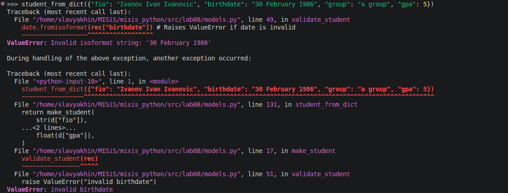
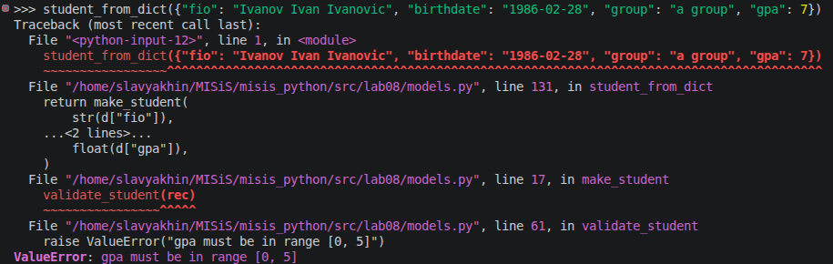
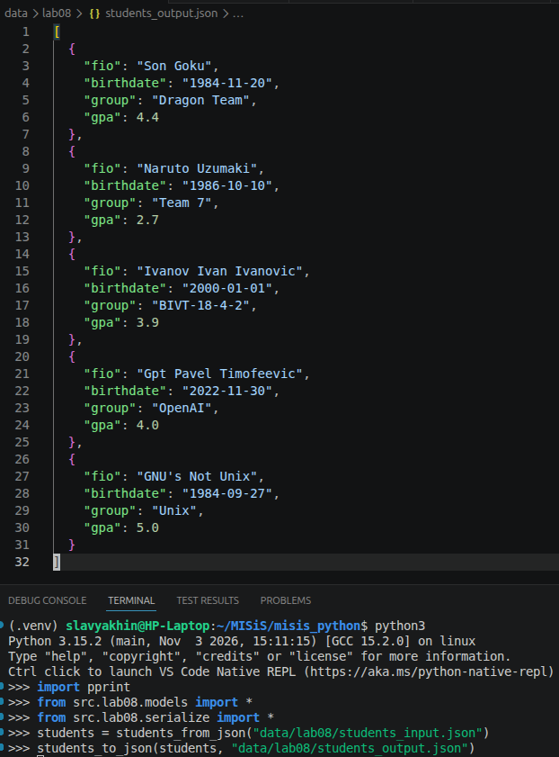
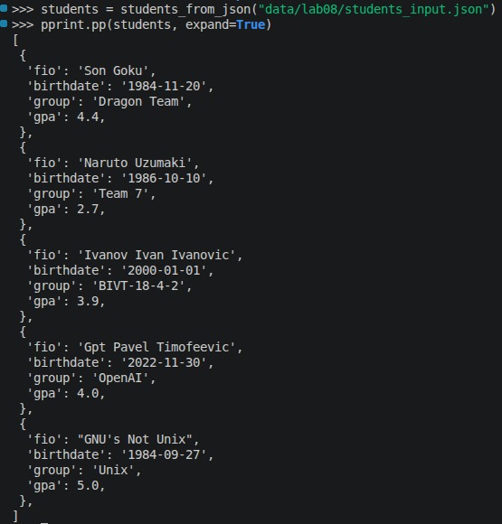

# ЛР8 – Модель данных без классов: запись `Student` как словарь, валидация и сериализация

## Задание A. Модель `Student` (`models.py`)

### Поля:

| Поле       | Тип   | Описание                |
|------------|-------|--------------------------|
| `fio`      | `str` | ФИО студента, непустая строка |
| `birthdate`| `str` | Формат `YYYY-MM-DD`, дата существует |
| `group`    | `str` | Группа, напр. `БИВТ-26-6-1`, непустая |
| `gpa`      | `float` | Средний балл 0…5; `int` допустим и приводится к `float` |

---

Во всей ЛР подразумевается, что сохраняются только исправные, провалидированные данные: запись содержит все необходимые поля и не имеет лишних.


### `make_student(fio, birthdate, group, gpa) -> dict`
— Конструктор записи.

``` python
    rec = {
        "fio": fio,
        "birthdate": birthdate,
        "group": group,
        "gpa": float(gpa),
    }

    validate_student(rec)
```


### _validate_student_fields(rec: dict) -> None:
— Дополнительно описана внутренняя функция для частичной валидации - наличия необходимых полей. Он полезен для десериализации.
``` python
    missing_fields = []
    for field in STUDENT_FIELDS:
        if not field in rec:
            missing_fields.append(field)
    if missing_fields:
        raise ValueError(f"no {", ".join(missing_fields)}")
```


### `validate_student(rec) -> None`
— Валидация. При ошибке — `ValueError`

``` python
    _validate_student_fields(rec)

    if not isinstance(rec["fio"], str):
        raise TypeError("fio must be string")
    if not rec["fio"].strip():
        raise ValueError("fio is empty")
    fio_list = list(rec["fio"].split())
    if not 2 <= len(fio_list) <= 3:
        raise ValueError("fio must contain 2 or 3 words")

    if not isinstance(rec["birthdate"], str):
        raise TypeError("birthdate must be string")
    try:
        date.fromisoformat(rec["birthdate"]) # Raises ValueError if date is invalid
    except ValueError:
        raise ValueError("invalid birthdate")

    if not isinstance(rec["group"], str):
        raise TypeError("group must be string")
    if not rec["group"].strip():
        raise ValueError("group is empty")

    if not isinstance(rec["gpa"], float | int):
        raise TypeError("gpa must be float or int")
    if not (0 <= rec["gpa"] <= 5):
        raise ValueError("gpa must be in range [0, 5]")

    if rec.keys() != STUDENT_FIELDS:
        raise ValueError("unwanted fields provided")
```

Неверная дата




Запись с `gpa = 7`



### `student_age(rec, today=None) -> int`
— Полных лет на дату `today` (по умолчанию `date.today()`); Учитывает день рождения в текущем году: булевое `True` неявно приводится к `q`, а `False` — к `0`.

``` python
    if today < birthdate:
        raise ValueError("not born yet")

    return today.year - birthdate.year - \
            ((today.month, today.day) < (birthdate.month, birthdate.day))
```


### `format_student(rec) -> str`
— красивый вывод: `Иванов И.И. (БИВТ-26-6-1), 19 лет, GPA 4.30`

``` python
    fio_list = list(rec["fio"].split())
    name = f'{fio_list[0].capitalize()} {"".join(map(lambda x: x[0].upper()+'.', fio_list[1:]))}'

    group = rec["group"].strip()

    age = student_age(rec)

    gpa = rec["gpa"]

    return f'{name} ({group}), {age} лет, GPA {gpa:2f}'
```


### `student_to_dict(rec) -> dict`
— **копия** записи для сериализации.

В данной ЛР следим за изменяемостью копируемых объектов. В python не выполняется **RAII** в классическом понимании. С иммутабельными (неизменяемыми) объектами переменная (не указатель или ссылка) удерживает связь до тех пор, пока значение переменной не потребовалось изменить. Тогда создаётся новый объект с новым значением.

Для изменяемых типов необходимо применять более сложные способы копирования. `copy.deepcopy(rec)`, например, рекурсивно копирует содержимое изменяемых объектов.

``` python
    new_rec = {
        "fio":       rec["fio"],        # str immutable
        "birthdate": rec["birthdate"],  # str immutable
        "group":     rec["group"],      # str immutable
        "gpa":       rec["gpa"],        # float immutable
    }
```


### `student_from_dict(d) -> dict`
— Десериализация: берёт из словаря ровно нужные ключи. Копирует значения. Приводит типы. Валидирует.

``` python
     _validate_student_fields(d)

    # make_student calls validation
    return make_student(
        str(d["fio"]),
        str(d["birthdate"]),
        str(d["group"]),
        float(d["gpa"]),
    )
```


#### `update_student(rec, **fields) -> dict`
— Возвращает **новую** запись с изменёнными полями. Исходная запись не меняется.
Неизвестный ключ в `fields` — `KeyError`.

``` python
    for key in fields.keys():
        if not key in STUDENT_FIELDS:
            raise KeyError(f"unknown key provided: {key}")

    return make_student(
        fio=        fields.get("fio", rec["fio"]),
        birthdate=  fields.get("birthdate", rec["birthdate"]),
        group=      fields.get("group", rec["group"]),
        gpa=        fields.get("gpa", rec["gpa"]),
    )
```


## Задание B. Модуль `serialize.py`

### `students_to_json(students, path)`
— Сохраняет список записей в JSON: массив объектов, `ensure_ascii=False`, `indent=2`.

``` python
    json_path = Path(path)
    with json_path.open("w", encoding=ENCODING) as f:
        json.dump(students, f, ensure_ascii=False, indend=2)
```



### `students_from_json(path) -> list[dict]`

-   читает JSON-массив
-   каждую запись прогоняет через `student_from_dict`
-   при битой записи — выбрана политика `strict`: первая же ошибка → `ValueError` с номером записи. Причина указана в предыдущей `ValueError` от `student_from_dict`.

``` python
    students = []

    json_path = Path(path)
    with json_path.open(encoding=ENCODING) as f:
        students = json.load(f)

    for i, rec in enumerate(students):
        try:
            students[i] = student_from_dict(rec)
        except (ValueError, TypeError) as err:
            raise ValueError(f"rec {i}: invalid") from err

    return students
```



### `students_from_csv(path) -> list[dict]`
— Чтение записей из CSV через `csv.DictReader` (заголовок `fio,birthdate,group,gpa`).
`gpa` приходит из CSV **строкой** — типы приводятся в функции десериализации `student_from_dict`.

``` python
    students = []

    csv_path = Path(path)
    with csv_path.open(encoding=ENCODING) as f:
        r = csv.DictReader(f)
        for i, row_dict in enumerate(r):
            try:
                students.append(student_from_dict(row_dict))
            except (ValueError, TypeError) as err:
                raise ValueError(f"rec {i}: invalid") from err
```
