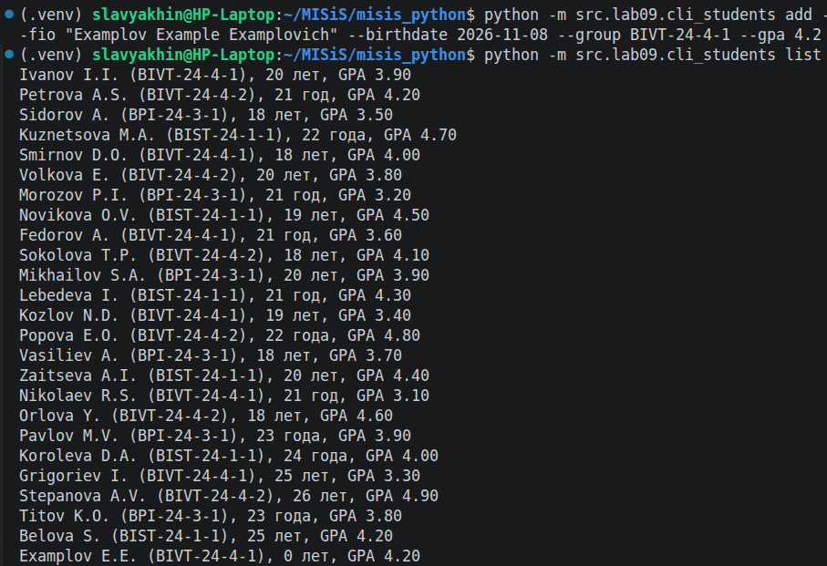
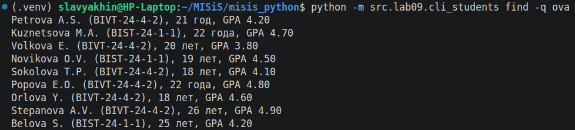
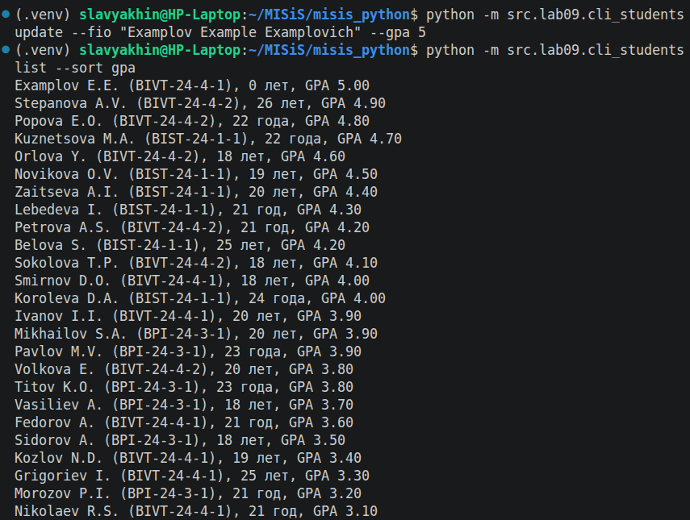
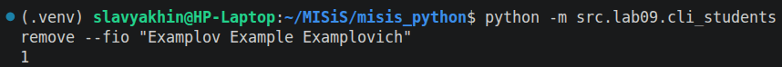
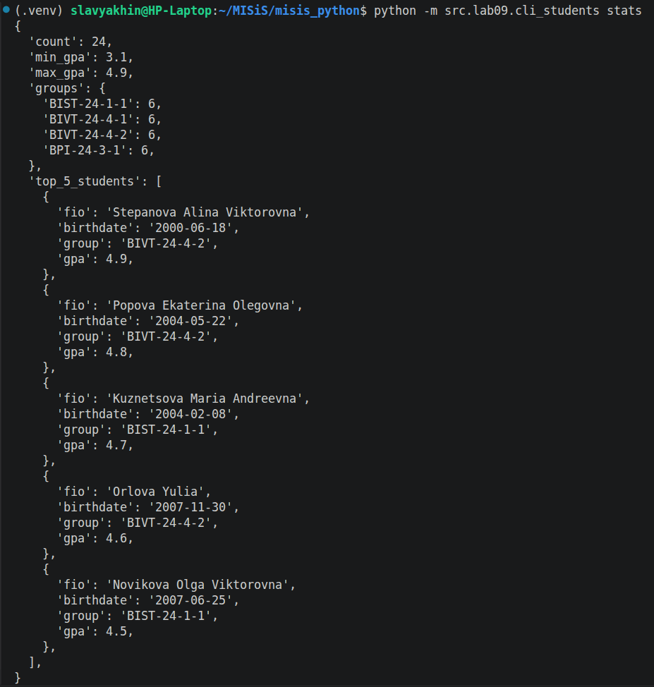

# ЛР9 — «База данных» на CSV: CRUD-функции над `students.csv` и CLI


# Задание A. Функции хранилища и CRUD (`group.py`)

**служебные:**

## `ensure_storage(path) -> None`
— если файла нет, создать его с одной строкой-заголовком `fio,birthdate,group,gpa`; создать недостающие каталоги

``` python
    if path.exists():
        return

    path.parent.mkdir(parents=True, exist_ok=True)
    with path.open("w", encoding=ENCODING) as f:
        f.write(','.join(STUDENT_FIELDS))
```

## `load_students(path) -> list[dict]`
— `csv.DictReader`, каждая строка через `student_from_dict`; отсутствие заголовка или лишние колонки — `ValueError`

Имена столбцов в csv должны совпадать с `STUDENT_FIELDS`.

``` python
    with path.open(encoding=ENCODING) as f:
        r = csv.DictReader(f)

        if r.fieldnames is None:
            raise ValueError("no fieldnames in csv")
        if dict.fromkeys(r.fieldnames) != STUDENT_FIELDS:
            raise ValueError("csv fieldnames do not match student rec")

        l = list(map(student_from_dict, r))
```

## `save_students(path, students) -> None`
— `csv.DictWriter` с `fieldnames=STUDENT_FIELDS`, `newline=""`, `encoding="utf-8"`

``` python
    ensure_storage(path)

    # newline="" crucial for writing csv in windows to avoid double blank lines
    with path.open("w", newline="", encoding=ENCODING) as f:
        w = csv.DictWriter(f, fieldnames=STUDENT_FIELDS)
        w.writeheader()
        w.writerows(students)
```

<br><br>


**CRUD:**

## `add_student(path, student) -> None`
— валидирует запись, дописывает в конец; `ValueError`, если запись с таким фио уже существует.

``` python
    students = load_students(path)

    validate_student(student)

    if any(s["fio"] == student["fio"] for s in students):
        raise ValueError

    students.append(student)

    save_students(path, students)
```

## `list_students(path, sort_by=None) -> list[dict]`
— список всех записей. Отсортированный по требованию. `sort_by` ∈ `{None, "fio", "gpa"}`. Сортировка по **GPA** по убыванию (отличники сначала).

``` python
    students = load_students(path)

    match sort_by:
        case None:
            pass
        case "fio":
            students.sort(key=(lambda s: s["fio"]))
        case "gpa":
            students.sort(key=(lambda s: s["gpa"]), reverse=True)
        case _:
            raise ValueError('unknonwn "sort_by"')

    return students
```

## `find_students(path, substr) -> list[dict]`
— все записи, у которых `substr` входит в `fio` **без учёта регистра**.

``` python
    students = load_students(path)

    substr = normalize(substr)

    substr_students = []
    for student in students:
        if substr in normalize(student["fio"]):
            substr_students.append(student)

    return substr_students
```

## `update_student(path, fio, **fields)`
— обновить поля **первой** записи с таким `fio`; неизвестный ключ — `KeyError`; результат валидируется; вернуть `True`, если запись найденаиначе `False`

``` python
    # search
    try:
        ind = key_index(students, fio, lambda rec, fio: rec["fio"] == fio)
    except ValueError:
        return False

    new_student = model_update_student(students[ind], **fields)

    students = students[:ind] + [new_student] + students[ind+1:]

    save_students(path, students)

    return True
```

### `key_index(l: Sequence[T_A], value: T_B, key: Callable[[T_A, T_B], bool]) -> int
Для удобства дополнительно написана функция поиска. `key_index` возвращает индекс первого элемента в `l`, для которого функция `key` с искомым `value` — `True`. Если нужный элемент не найден, поднимается исключение `ValueError`.

``` python
    for i, elem in enumerate(l):
        if key(elem, value):
            return i

    raise ValueError("mathcing value not found")
```

## `remove_student(path, fio)`
— удалить **все** записи с таким `fio`, вернуть количество удалённых

``` python
    new_students = [rec for rec in students if rec["fio"] != fio]

    save_students(path, new_students)

    return len(students) - len(new_students)
```

<br><br>


## `stats(path) -> dict`
— возвращает словарь следующей структуры:

```python
    """
    {
        "count": total students count,
        "min_gpa": min gpa,
        "max_gpa": max gpa,
        "avg_gpa": avg gpa,
        "groups": {
            "БИВТ-26-6-1": students count,
            "БИВТ-26-6-2": students count,
            ...
        },
        "top_5_students": [
            {"fio": "...", "gpa": ...},
            ...
        ]
    }
    """

    students = list_students(path, sort_by="gpa")

    d = dict()

    d["count"] = len(students)
    d["min_gpa"] = students[-1]["gpa"]
    d["max_gpa"] = students[0]["gpa"]

    groups = dict()
    for s in students:
        groups[s["group"]] = groups.get(s["group"], 0) + 1

    groups = dict(sorted(groups.items()))

    d["groups"] = groups

    d[f"top_{len(students) if len(students) < 5 else 5}_students"] = students[:5]

    return d
```


<br><br>


# Задание B. CLI (`cli_students.py`)

Подкоманды argparse, общий параметр `--db` с путём к хранилищу
(по умолчанию `data/lab09/students.csv`):

## `add --fio ... --birthdate ... --group ... --gpa ...`



## `list [--sort fio|gpa]`
Каждую запись выводит при помощи `format_student`

## `find --q <подстрока>`
Аналогично `list` Каждую запись выводит при помощи `format_student`



## `update --fio ... [--gpa ...] [--group ...] [--birthdate ...]`



## `remove --fio ...`
— печатает количество удалённых записей.



## `stats`


