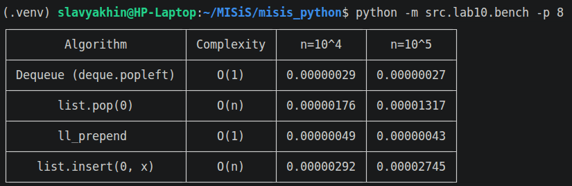
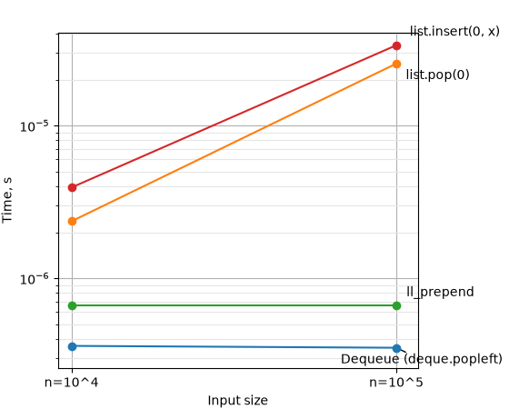

# ЛР10 — Структуры данных: Stack, Queue, Linked List и бенчмарки

# Задание A. Стек и очередь (`src/lab10/structures.py`)

Классы ене используются. Функции принимают структуру на вход первым аргументом.


## Стек

Структура данных «стек» (LIFO) на базе `list`.

### `stack_create() -> list`
``` python
    return list()
```

### `stack_from_list(l: list) -> list`
Десериализация. Элемент в конце списка l[-1] становится на вершину стека.

``` python
    st = stack_create()
    for value in l:
        stack_push(st, value)
```

### `stack_to_list(st: list) -> list`
Сериализация.

``` python
    l = list()
    while not stack_is_empty(st):
        l.append(stack_pop(st))
    l = l.reverse()
    return l
```

### `stack_push(st, item) -> None`  
Добавить элемент на вершину стека.
``` python
    st.append(item)
```

### `stack_pop(st) -> Any`  
Снять верхний элемент стека и вернуть его. Если стек пуст — поднимается исключение `EmptyStackError`

``` python
    if len(st) == 0:
        raise EmptyStackError("Stack is empty")

    return st.pop()
```

### `stack_peek(st) -> Any | None`  
Вернуть верхний элемент **без удаления**. Если стек пуст — поднимается исключение `EmptyStackError`

``` python
    if stack_is_empty(st):
        raise EmptyStackError("Stack is empty")

    return st[-1]
```

### `stack_is_empty(st) -> bool`  
Вернуть `True`, если стек пуст, иначе `False`.

``` python
    return not st
```


## Задача на стек

### `is_balanced(s: str) -> bool`  
Правильная ли скобочная последовательность для скобок `()`, `[]`, `{}`.

Остальные символы игнорируются.
``` python
    st = stack_create()
    bracket_pair = {
        ')': '(',
        ']': '[',
        '}': '{'
    }
    for c in s:
        if c in '([{':
            stack_push(st, c)
        elif c in ')]}':
            if stack_is_empty(st) or stack_pop(st) != bracket_pair[c]:
                return False

    return stack_is_empty(st)
```

### `rpn(expr: str) -> float`
— калькулятор обратной польской записи на стеке: `"3 4 + 2 *"` → `14.0`

Запись считывается последовательно. Операнды записываются на стек. Если встретился оператор, пробуем взять нужное количество операндов из стека и применить оператор к ним. Результат записывается в тот же стек.

``` python
    unary_operators = ['~']
    binary_operators = ['+', '-', '*', '/', '%', '**', '//']

    values_st = stack_create()

    for token in expr.split():
        if token in unary_operators:

            try:
                a = stack_pop(values_st)
                assert isinstance(a, float)
            except EmptyStackError:
                raise ValueError(f"Invalid rpn: no operand for '{token}' operator")

            match token:
                case '~':
                    stack_push(values_st, -a)

        elif token in binary_operators:

            try:
                a = stack_pop(values_st)
                assert isinstance(a, float)
                b = stack_pop(values_st)
                assert isinstance(b, float)

            except EmptyStackError:
                raise ValueError(f"Invalid rpn: no operand for '{token}' operator")

            match token:
                case '+':
                    stack_push(values_st, a+b)
                case '-':
                    stack_push(values_st, a-b)
                case '*':
                    stack_push(values_st, a*b)
                case '/':
                    stack_push(values_st, a/b)
                case '%':
                    stack_push(values_st, a%b)
                case '**':
                    stack_push(values_st, a**b)
                case '//':
                    stack_push(values_st, a//b)
        else:
            try:
                stack_push(values_st, float(token))
            except ValueError:
                raise ValueError(f'Non-convertable to float token "{token}"')

    try:
        result = stack_pop(values_st)
        if not stack_is_empty(values_st):
            raise ValueError("Not all tokens used")

        assert isinstance(result, float)

        return result
    except EmptyStackError:
        raise ValueError("No values in the rpn")
```

## Очередь

Структура данных «очередь» (FIFO) на базе `collections.deque`.

### `queue_create() -> deque`
``` python
    return deque()
```

### `queue_from_list(l: list) -> deque`
``` python
    q = queue_create()
    for value in l:
        queue_enqueue(q, value)
    return q
```

### `queue_to_list(q: deque) -> list`
``` python
    l = []
    while not queue_is_empty(q):
        l.append(queue_dequeue(q))
```

### `queue_enqueue(q, item) -> None`  
Добавить элемент в конец очереди.
``` python
    q.append(item)
```

### `queue_dequeue(q) -> Any`  
Взять элемент из начала очереди и вернуть его.  

Если очередь пустая — выбрасывается исключение `EmptyQueueError`.
```python
    if queue_is_empty(q):
        raise EmptyQueueError("Queue is empty")

    return q.popleft()
```

### `queue_peek(q) -> Any | None`  
Вернуть первый элемент **без удаления**.  

Если очередь пустая — выбрасывается исключение `EmptyQueueError`.
``` python
    if queue_is_empty(q):
        raise EmptyQueueError("Queue is empty")

    return q[0]
```

### `queue_is_empty(q) -> bool`  
Вернуть `True`, если очередь пуста.
``` python
    return not bool(q)
```

---

<br><br>

# Задание B. Односвязный список (`src/lab10/linked_list.py`)

Нужно реализовать узел и функции над списком.

## `class Node`

**Назначение:** узел односвязного списка. Единственный класс в семестре — и у него только конструктор.

**Атрибуты:**

- `self.value: Any` — значение элемента.
- `self.next: Node | None` — ссылка на следующий узел или `None`, если это последний узел.

``` python
class Node:
    def __init__(self, value, next=None):
        self.value = value
        self.next = next
    def __reduce__(self):
        """ Serialize and deserialize """
        return ll_from_list, (ll_to_list(self),)
```

- `__reduce__` — метод оказался необходим для бенчмарка. Сериализация и десериализация структуры для передачи в подпроцесс (pickle). Без `reduce` сериализация производится рекурсивно, на больших даных стек рекурсии переполняется.

Никаких других методов у `Node` нет. Это запись из двух полей; всё поведение — в функциях ниже.

---

## Функции над списком

**Представление:** список задаётся **ссылкой на голову** — `Node` или `None` для пустого списка.


### `ll_copy(head: Node | None) -> Node | None`
``` python
    new_head = Node(head.value, None)
    cur = new_head
    while head.next is not None:
        cur.next = Node(head.next.value, None)
        cur = cur.next
        head = head.next

    return new_head
```

### `ll_from_list(values: list) -> Node | None`
Собрать список из обычного `list`

``` python
    head = Node(values[0], None)
    cur = head
    for value in values[1:]:
        cur.next = Node(value, None)
        cur = cur.next

    return head
```

### `ll_to_list(head: Node | None) -> list`
Обратно: значения от головы к хвосту.

``` python
    l = list()
    while head is not None:
        l.append(head.value)
        head = head.next

    return l
```

### `ll_length(head: Node | None) -> int`
Считает длину за O(n). Лучше, разумеется хранить длину полем.

``` python
    counter = 0
    while head is not None:
        counter += 1
        head = head.next

    return counter
```

### `ll_prepend(head: Node | None, value) -> Node`
Добавить элемент в начало за `O(1)`. Возвращает новую голову.

``` python
    return Node(value, head)
```

### `ll_append(head: Node | None, value) -> Node`
Добавить элемент в конец за `O(n)` проходом от `head`. Возвращает голову (для пустого списка — новую).

``` python
    if head is None:
        return Node(value)

    cur = head

    while cur.next is not None:
        cur = cur.next

    cur.next = Node(value)

    return head
```


### `ll_insert(head: Node | None, idx: int, value) -> Node`
Вставить элемент по индексу `idx`.

Допускается вставка в начало (`idx == 0`) и в конец (`idx == ll_length(head)`);

При индексе вне диапазона `[0, len]` — `IndexError`.

``` python
    if idx == 0:
        return ll_prepend(head, value)

    if head is None:
        raise IndexError("index out of range")

    i, cur = 1, head

    while cur.next is not None and i != idx:
        cur = cur.next
        i += 1

    if i != idx:
        raise IndexError("index out of range")

    cur.next = Node(value, cur.next)

    return head
```

### `ll_remove(head: Node | None, value) -> Node | None`
Удалить первое вхождение значения. Если не найдено, ничего не происходит.

``` python
    if head is None:
        return None

    if head.value == value:
        return head.next

    cur = head

    while cur.next is not None and cur.next.value != value:
        cur = cur.next

    if cur.next is not None:
        cur.next = cur.next.next

    return head
```

### `ll_remove_at(head: Node | None, idx: int) -> Node | None`
Удалить элемент по индексу `idx` (при некорректном индексе — `IndexError`).

``` python
    if head is None:
        raise IndexError("the linked list is empty")

    if idx == 0:
        return head.next

    i, cur = 1, head

    while cur.next is not None and i != idx:
        cur = cur.next
        i += 1

    if i != idx:
        raise IndexError("index out of range")

    # Deletion
    if cur.next is not None:
        cur.next = cur.next.next

    return head
```

### `ll_reverse(head: Node | None) -> Node | None`
Развернуть список **на месте**, итеративно, тремя ссылками `prev / cur / nxt`.

``` python
    if head is None:
        return None

    prev = None
    cur = head
    nxt = head.next

    while nxt is not None:
        cur.next = prev

        prev = cur
        cur = nxt
        nxt = cur.next

    return cur
```

### `ll_repr(head: Node | None) -> str`
Возвращает строковое представление, например:  `[1] -> [2] -> [3] -> None`; для пустого списка — `None`.

``` python
    l = [ f"[{v}]" for v in ll_to_list(head) ]
    l.append("None")
    return ' -> '.join(l)
```

### `ll_middle(head: Node | None) -> Node | None`
— средний узел за **один** проход двумя указателями (быстрый и медленный)

``` python
    if head is None:
        return None

    slow, fast = head, head

    while fast.next is not None and fast.next.next is not None:
        slow = slow.next # type: ignore
        fast = fast.next.next

    return slow
```

### `ll_has_cycle(head: Node | None) -> bool`
— есть ли цикл, алгоритм Флойда, без множества посещённых

``` python
    slow, fast = head, head

    while fast is not None and fast.next is not None:
        slow = slow.next # type: ignore
        fast = fast.next.next
        
        if fast == slow:
            return True

    return False
```

<br><br>

# Задание B* двусвязный список

Все те же методы, но с двумя ссылками в ноде.

``` python
class DoublyNode:
    def __init__(self, value, prev: DoublyNode | None=None, next: DoublyNode | None=None):
        self.value = value
        self.prev = prev
        self.next = next
```

<br><br>

# Задание C. Бенчмарки (`src/lab10/bench.py`)

Использован тот же бенчмарк, что и для `lab07`



